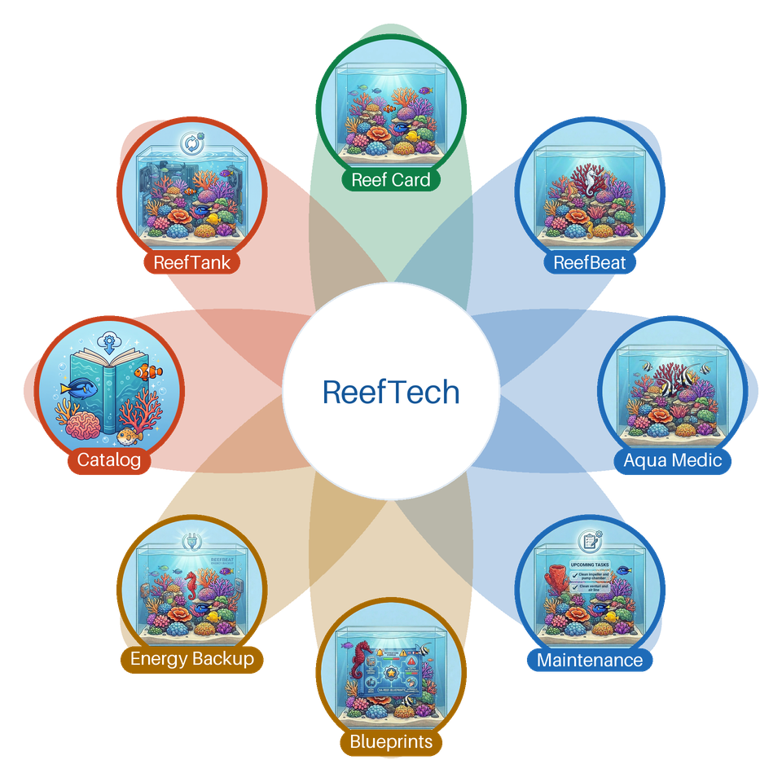

# Test d'affichage de la fleur animée

Fichier temporaire, à supprimer après le test. Le chargement peut prendre un instant.

À contrôler dans chaque cas : les 8 icônes sont visibles, les pétales s'allument chacun leur tour, « ReefTech » cède la place au nom de chaque projet, et le cycle complet dure environ 20 secondes.

## A. Lien relatif (même dépôt)

## B. URL absolue, comme depuis les autres dépôts

## C. Forme finale dans un README : image cliquable vers le site

## D. Comparaison : image fixe actuelle

